# Project status

What's done, where we are, and what's next. Updated every time something is finished.

**Legend:** ✅ done · 🔄 in progress · ⏳ not started

## Big picture

```mermaid
flowchart LR
  A["Define MVP ✅"] --> B["Choose tech ✅"] --> C
  subgraph C["Harness setup 🔄"]
    direction TB
    C1["CLAUDE.md rules ✅"]
    C2["Commit settings ✅<br/>personal email, no Co-Authored-By"]
    C3["/ticket skill ✅"]
    C4["Permission rules ✅"]
    C5["STATUS.md ✅"]
    C6["Notify-me hook ⏳"]
    C7["Shared dev setup ✅<br/>Flutter 3.47.9 pinned, setup.sh"]
  end
  C --> D
  subgraph D["Reading test — the gate ⏳"]
    direction TB
    D1["Check Mac tools ✅"]
    D4["Install Flutter + Android tools ⏳"]
    D2["Three ticket photos ⏳"]
    D3["Reading self-check script ⏳"]
  end
  D --> E["Build the app ⏳"]
```

## Last session (2026-10-30 to 2026-11-02)

- Defined the MVP and wrote the README.
- Decided: downloaded app, Flutter, read the ticket on the phone with ML Kit, no cost per use.
- Set up git and GitHub (public repo `nampham2101/lotteryScanV2`).
- Harness: CLAUDE.md rules, commit settings, `/ticket` skill, permission rules, this status file.

## Next up

Agreed order before writing code:

1. ~~Check what's installed on the Mac~~ ✅ (2026-11-02)
   - Installed: Homebrew, Android Studio, Android SDK (API 34–36.1), Android emulator with a `Pixel_10` device, Java 21, Xcode 27.1 with iOS simulators.
   - Missing: Flutter, Android command-line tools, CocoaPods (only needed for iOS, later).
2. Install Flutter and the Android command-line tools: run `./setup.sh` (see [SETUP.md](SETUP.md)).
   - Done (2026-11-03): Flutter pinned to 3.47.9 with FVM, `setup.sh` (Mac and Linux, asks before each install) and `docs/SETUP.md` written. No Docker.
3. Nam sends the three ticket photos.
4. Write `docs/CONVENTIONS.md`.
5. Write the first ticket with `/ticket`: "Test reading the three ticket fields from photos".

## Open questions

- Where the winning results come from, for free.
- Whether the ML Kit reader handles Vietnamese accents in province names.
- Android first? (leaning yes)

## Waiting on Nam

- Three ticket photos from three different miền Nam provinces.
- Android command-line tools: install from Android Studio → Settings → Android SDK → SDK Tools tab.
- Accept the Android licenses (`flutter doctor --android-licenses`, after Flutter is installed). It asks you to type `y`.
