# Project status

What's done, where we are, and what's next. Updated every time something is finished.

**Legend:** ✅ done · 🔄 in progress · ⏳ not started

"Latest session" shows only the most recent session. Older history is in `git log`. Ticket details live in [BACKLOG.md](BACKLOG.md), workflow details in [WORKFLOW.md](WORKFLOW.md).

## Big picture

```mermaid
flowchart LR
  A["Define MVP ✅"] --> B["Choose tech ✅"] --> C
  subgraph C["Harness setup 🔄"]
    direction TB
    C1["CLAUDE.md rules ✅"]
    C2["Commit settings ✅<br/>personal email, no Co-Authored-By"]
    C3["/ticket skill ✅<br/>drafts + posts from /refine"]
    C8["/refine skill ✅<br/>discuss, split, acceptance criteria"]
    C9["Ticket workflow /work 🔄<br/>/work, test writer, implementer, reviewer built<br/>CI to come"]
    C4["Permission rules ✅"]
    C5["STATUS.md ✅"]
    C6["Notify-me hook ⏳"]
    C7["Shared dev setup ✅<br/>Flutter 3.47.9 pinned, setup.sh"]
  end
  C --> D
  subgraph D["Reading test — the gate ⏳"]
    direction TB
    D1["Check Mac tools ✅"]
    D4["Install Flutter + Android tools ✅"]
    D2["Three ticket photos ⏳"]
    D3["Reading self-check script ⏳"]
  end
  D --> E
  subgraph E["Build the app 🔄"]
    direction TB
    E1["Blank Android app ✅<br/>ticket #2, merged"]
    E2["Home screen ✅<br/>ticket #4, merged"]
    E3["Portrait lock ✅<br/>ticket #5, PR #7"]
  end
```

## Latest session (2026-11-04)

- Backlog item 3 refined and split into two tickets, both posted and unassigned. #8 take the photo: "Quét vé" asks for camera access, opens the sketch 2 screen, the shutter keeps the photo inside the app and returns home, and the phone's back goes home. #9 camera refused (builds on #8): one pop-up on home, whether refused once or for good. Both need test cases, and passing on the `Pixel_10` emulator is enough. A camera or save failure is not included.
- Built the reviewer agent (Opus 5.5) and added it to `/work` as a new step between the checks and the pull request. It reviews the finished work with fresh eyes, proves each "Done when" item from the saved evidence, and ticks the boxes only if everything looks good. It reports problems instead of fixing them: code problems go to the implementer, tests that prove nothing go to the test writer, and these share the 3 fix rounds. The block-push hook applies. Not yet run live.
- Decision: CI waits until #8 is merged, instead of "before tickets get bigger". It wouldn't add much for #8 because the camera proof comes from the emulator, #8 is already the reviewer's first live run, and #8 will show how tests behave with a real camera add-on. Accepted risk: until then, "tests must pass to merge" depends only on `/work`, since `main` has no protection rules. Bring CI forward if `/work` ever merges something that fails on a clean copy, or merges with failing tests.
- Decision: running `/work` is now the go signal, and `/work` assigns the ticket to Nam when it starts, so Nam doesn't have to assign it on GitHub first. Both `/work 8` and `/work ticket 8` work. Not yet run live.

## Next up

1. Nam runs `/work 8`, which is also the reviewer's first live run.
2. Design CI right after #8 is merged, so "tests must pass to merge" is enforced. Confirm GitHub Actions is free for this public repository first.
3. Teach `/refine` and `/ticket` to update an existing ticket, only once a ticket actually hits an unclear criterion.
4. Backlog items 5–6 (reading the ticket, then the go / no-go gate) wait on Nam's three photos.

## Open questions

- Where the winning results come from, for free.
- Whether the ML Kit reader handles Vietnamese accents in province names.

## Waiting on Nam

- Three ticket photos from three different miền Nam provinces.
