# Project status

What's done, where we are, and what's next. Updated every time something is finished.

**Legend:** ✅ done · 🔄 in progress · ⏳ not started

"Latest session" shows only the most recent session. Older history is in `git log`. Ticket details live in [BACKLOG.md](BACKLOG.md), workflow details in [WORKFLOW.md](WORKFLOW.md).

## Big picture

```mermaid
flowchart LR
  A["Define MVP ✅"] --> B["Choose tech ✅"] --> C
  subgraph C["Harness setup 🔄"]
    direction TB
    C1["CLAUDE.md rules ✅"]
    C2["Commit settings ✅<br/>personal email, no Co-Authored-By"]
    C3["/ticket skill ✅<br/>drafts + posts from /refine"]
    C8["/refine skill ✅<br/>discuss, split, acceptance criteria"]
    C9["Ticket workflow /work 🔄<br/>/work, test writer, implementer, reviewer built<br/>CI to come"]
    C4["Permission rules ✅"]
    C5["STATUS.md ✅"]
    C6["Notify-me hook ⏳"]
    C7["Shared dev setup ✅<br/>Flutter 3.47.9 pinned, setup.sh"]
  end
  C --> D
  subgraph D["Reading test — the gate ⏳"]
    direction TB
    D1["Check Mac tools ✅"]
    D4["Install Flutter + Android tools ✅"]
    D2["Ticket photos ✅<br/>four from three provinces<br/>in docs/photos/"]
    D5["Reading rule ✅<br/>ticket #14, PR #15"]
    D6["ML Kit test ✅<br/>ticket #16, PR #17"]
    D3["Reading self-check script ⏳"]
  end
  D --> E
  subgraph E["Build the app 🔄"]
    direction TB
    E1["Blank Android app ✅<br/>ticket #2, merged"]
    E2["Home screen ✅<br/>ticket #4, merged"]
    E3["Portrait lock ✅<br/>ticket #5, PR #7"]
    E4["Take the photo ✅<br/>ticket #8, PR #11"]
    E5["Camera refused pop-up ✅<br/>ticket #9, PR #12"]
    E6["Photo screen ✅<br/>ticket #10, PR #13"]
  end
```

## Latest session (2026-11-05)

- #16 merged (PR #17): ML Kit is in the app and ran on all five pictures on `Pixel_10`, and everything it read is saved with positions in `docs/evidence/16/`. The big ticket number along the bottom wasn't read as digits on any picture. The number was found as one word in small print on three of the five, the date on four and the province on four, and accents came through only partly. Nam looked at the results and is satisfied with them. The release APK grew from 46.7 MB to 78.2 MB. Backlog items 45–56 added.
- #16 used all 3 fix rounds, and the fourth review still found two mistakes in the results summary: a missing Đà Lạt misread and a wrong position for `C871723`. `/work` stopped. Decision: Nam accepted both without a fix and told `/work` to go on, so the ticket's "Any misread is written down" box is ticked with one known gap. Both are in backlog item 45, to use when refining item 6.
- Decision: the release app has no internet permission. ML Kit's libraries added it, the README promises reading works offline, and ML Kit read all five pictures identically without it. `/work` decided this and told Nam afterwards. Revisit if the app needs the internet, for example for winning results.
- Finding: a stuck "isn't responding" pop-up on `Pixel_10` failed four `flutter drive` runs in #16's checks. It also appeared on 3 November, before ML Kit was added, and a reboot cleared it, so all four passed. Backlog item 55. #8's camera tests didn't run in this ticket, because they need the Pixel 7 held by hand.
- Backlog item 6 refined and split. The first ticket, posted unassigned as #16, is an ML Kit test: add ML Kit, run it on five pictures on `Pixel_10`, and save everything it reads with positions, with no reading rule and no screen change. The rest of item 6 gets refined after its results.
- Decisions for the rest of item 6: the saved-photo half of the gate is report only, and Nam decides go or no-go from the results. The real-ticket half waits for item 7. A photo with any unreadable field gives "couldn't read" plus the failed field names, with no field values. The province is matched against a fixed list of Nam's 21 miền Nam names, ignoring accents. The check runs on `Pixel_10` from saved JPGs, and the photos are kept in the project, visible to the public.
- Decision: ML Kit stays for now. It can't read a ticket the way Claude does, and only an AI model can, but an AI service would break "read on the phone" and "no cost each time". Revisit if ML Kit fails the gate.
- Finding: a 2019 Đà Lạt ticket breaks the "one rule for every province" in `docs/TICKET-READING.md`. Its top line isn't "XỔ SỐ KIẾN THIẾT", "ĐÀ LẠT" sits about 40% down, and its date has a weekday in front. ML Kit also reports text, not the ticket's edges, so how the app finds the fields waits for the ML Kit test. The Đà Lạt picture joins that test as an extra look, not as part of the four-photo gate.
- #14 merged (PR #15): `docs/TICKET-READING.md` now holds the reading rule, the area sizes and the four correct answers, and the README's gate says four photos from three provinces. The top area is 20% and the bottom band 35% of the ticket's height, checked on all four photos by eye. Nam gave all permissions for this run, so `/work` ran without stopping. Nobody had said where the photos were, so `/work` looked and found them in Downloads as `IMG_5902` to `IMG_5905`. The reviewer found two problems in its first review, wrong band notes and wrong figures. Both were fixed in one round, and the second review was clean. Analyze and the 6 widget tests passed. Backlog items 40–44 added.
- Decision: the rule also ignores the sideways copies on the ticket's left and right edges, which the ticket didn't ask for. All four tickets have large sideways print on the right edge, inside the bottom band, and a right-to-left search reaches it first, so the ticket's rule fails without this. Item 6 should be refined with this exception (backlog item 40). Accepted risk: the 20% and 35% margins are about the same size as the by-eye measuring. Revisit when more tickets are checked (backlog item 42).
- Backlog item 5 refined as one ticket and posted unassigned as #14. It delivers a written reading rule only, in a new `docs/TICKET-READING.md`, with no test cases needed. Decision: one rule for every province, measured from the ticket's edges. The province comes from the title strip on top, the date is the first date found going left to right along the bottom, and the ticket number is the first six digits found going right to left along the bottom. Boxes per province aren't needed, because no fixed line separates the date from the number on all three layouts. Finding the ticket and these areas in a photo moves to item 6. Accepted risk: Bạc Liêu's faint doubled digits may read as 12 digits. Item 6 tests this.
- Decision: the test set is four photos from three provinces, with Bạc Liêu twice, instead of the gate's three. The README changes with item 5's ticket.
- #10 merged (PR #13): the shutter now opens a temporary photo screen that shows only the newest photo, fitted whole, with no text, buttons or zooming. Back goes home, and "Quét vé" opens the camera again. The reviewer found two problems in its first review, a kept photo replaced after leaving and pasted test helpers. Both were fixed in one round, and the second review was clean. All #10 tests passed on `Pixel_10`. Because the ticket changed shared helpers and camera code, #8's 12 tests passed on the Pixel 7 and #9's and #5's tests on `Pixel_10`. #8's test no longer expects home after the shutter, on purpose, because #10 replaces that. Backlog items 33–39 added and item 32 extended. First live run of the test writer choosing devices and of `/work` running only the affected older tests.
- #9 merged (PR #12): when camera access is refused, once or for good, home shows a pop-up "Cần dùng camera" with "Đóng", and the camera screen doesn't open. Allowing the camera later in Settings lets "Quét vé" open it as normal. First live run of the reviewer before the checks: it found no problems on the first review, so no fix rounds were used. All #9 tests passed on `Pixel_10`, and #8's 12 camera tests passed again on the Pixel 7. Backlog items 26–32 added from this ticket; item 25 is Nam's own. Three side runs by the agents have no saved output, which is a gap against the checklist's "every test run" wording (backlog item 32).
- Backlog item 4 refined as one ticket and posted unassigned as #10. A temporary screen for the reading gate, with no sketch: the shutter goes to the photo instead of home, the screen shows only the photo, fitted whole with no zooming, and the phone's back goes home. It builds on #8, needs test cases, and must pass on the Pixel 7.
- Backlog item 3 refined and split into two tickets, both posted and unassigned. #8 take the photo: "Quét vé" asks for camera access, opens the sketch 2 screen, the shutter keeps the photo inside the app and returns home, and the phone's back goes home. #9 camera refused (builds on #8): one pop-up on home, whether refused once or for good. Both need test cases, and passing on the `Pixel_10` emulator is enough. A camera or save failure is not included.
- Built the reviewer agent (Opus 5.5) and added it to `/work` as a new step between the checks and the pull request. It reviews the finished work with fresh eyes, proves each "Done when" item from the saved evidence, and ticks the boxes only if everything looks good. It reports problems instead of fixing them: code problems go to the implementer, tests that prove nothing go to the test writer, and these share the 3 fix rounds. The block-push hook applies. Not yet run live.
- Decision: CI waits until #8 is merged, instead of "before tickets get bigger". It wouldn't add much for #8 because the camera proof comes from the emulator, #8 is already the reviewer's first live run, and #8 will show how tests behave with a real camera add-on. Accepted risk: until then, "tests must pass to merge" depends only on `/work`, since `main` has no protection rules. Bring CI forward if `/work` ever merges something that fails on a clean copy, or merges with failing tests.
- Decision: running `/work` is now the go signal, and `/work` assigns the ticket to Nam when it starts, so Nam doesn't have to assign it on GitHub first. Both `/work 8` and `/work ticket 8` work. Not yet run live.
- #8 merged (PR #11): "Quét vé" asks for camera access from home, opens the sketch 2 camera screen once allowed, and the shutter keeps one private photo and returns home. Back returns home with no photo taken. This was the first live run of the reviewer: 4 reviews and all 3 fix rounds.
- Decision: testing uses Nam's Pixel 7 instead of the `Pixel_10` emulator, because the emulator's back camera shows a still scene. The portrait lock tests stay on the emulator, because they fake turning the phone. Accepted risk: camera tests need Nam holding the phone and moving it, so they can't run unattended. Revisit when designing CI (backlog item 22).
- Decision: the dashed frame stays square, about 40% of the Pixel 7's height. Real phones are taller than the sketch, so it can't be both square and 53% of the height. Revisit if lining up a real ticket is awkward.
- Decision: `/work` checks the evidence link once the pull request is open, not the reviewer, because the reviewer runs before the pull request exists. `/work` and the reviewer's instructions don't say this yet (backlog item 21).
- Decision: tests now run on a real phone when one is connected, otherwise on `Pixel_10`. This widens the Pixel 7 decision above from one ticket to a rule in `/work` and the test writer. Tests that control the emulator itself stay on `Pixel_10`. Tests that need a real camera picture and find no phone stop and tell Nam. Not yet run live.
- Decision: `/work` now runs the reviewer before the checks, because #8 ran a full test pass before each of its 4 reviews. The reviewer reviews code only, across all the ticket's changes every time, and reports every problem at once. The implementer fixes them all in one round, and improvements go to the backlog. The checks step now also proves "Done when" and ticks the boxes. Any code fix after a failed check goes back through the reviewer; a run problem just reruns the check. Manual steps now cover only what automated tests can't prove, and `/refine`'s proof line accepts saved test output. Accepted risk: `/work` judges its own evidence. Revisit if a ticket merges with a "Done when" item that wasn't really proven. #9 and #10 still carry the old proof line. Not yet run live.
- Added `/ticket update <issue number>`: it shows Nam each changed line, old and new, and changes the ticket only after Nam's yes. `/refine` stays the place to change "Done when" items. Built now instead of waiting for an unclear criterion, because the workflow changes left #9 and #10 out of date.
- Decision: the test writer now picks the device for each test, replacing the phone-first rule above. A device named in the ticket wins. Otherwise the default is `Pixel_10`, and a real phone is used only when the emulator can't prove the item, with phone tests in their own file. "It must pass on the Pixel 7" is removed from #10. Accepted risk: a bug that only shows on a real phone may first appear at the release check. Revisit if that happens. Not yet run live.
- Decision: `/work`'s checks now run analyze, all the widget tests and the ticket's own device tests and manual steps. Older device tests run only if the ticket touched their code or shared test helpers; the rest wait for a regression run before a release. That run isn't designed yet. Accepted risk: a ticket can break an older feature and stay on `main` until then. Revisit if that happens. Not yet run live.
- Decision: the test writer and the implementer now follow the same limit as the checks. The test writer runs only the ticket's new tests for its first failing run, and doesn't try them against a stand-in version of the feature. The implementer runs analyze, the widget tests and the ticket's integration tests. Each runs older tests only if it changed them or shared test helpers. Revisit if the checks often fail on older tests these agents could have caught. Not yet run live.

## Next up

1. Decide how to handle backlog items 21–22 (`/work`'s link rule, someone holding the phone during a run, and tests that need a moving picture), since CI depends on them.
2. Design CI, so "tests must pass to merge" is enforced. Confirm GitHub Actions is free for this public repository first.
3. Design the regression run, which is needed before the first release.
4. Refine the rest of item 6 from #16's results in `docs/evidence/16/summary.md`, using `docs/TICKET-READING.md` and backlog items 40–42 and 45.

## Open questions

- Where the winning results come from, for free.
- Whether Vietnamese accents in province names matter: in #16 they came through only partly, so item 6 needs to decide.

## Waiting on Nam

Nothing right now.
