# Project status

What's done, where we are, and what's next. Updated every time something is finished.

**Legend:** ✅ done · 🔄 in progress · ⏳ not started

"Latest session" shows only the most recent session. Older history is in `git log`. Ticket details live in [BACKLOG.md](BACKLOG.md), workflow details in [WORKFLOW.md](WORKFLOW.md).

## Big picture

```mermaid
flowchart LR
  A["Define MVP ✅"] --> B["Choose tech ✅"] --> C
  subgraph C["Harness setup 🔄"]
    direction TB
    C1["CLAUDE.md rules ✅"]
    C2["Commit settings ✅<br/>personal email, no Co-Authored-By"]
    C3["/ticket skill ✅<br/>drafts + posts from /refine"]
    C8["/refine skill ✅<br/>discuss, split, acceptance criteria"]
    C9["Ticket workflow /work 🔄<br/>test writer + implementer built, see WORKFLOW.md"]
    C4["Permission rules ✅"]
    C5["STATUS.md ✅"]
    C6["Notify-me hook ⏳"]
    C7["Shared dev setup ✅<br/>Flutter 3.47.9 pinned, setup.sh"]
  end
  C --> D
  subgraph D["Reading test — the gate ⏳"]
    direction TB
    D1["Check Mac tools ✅"]
    D4["Install Flutter + Android tools ✅"]
    D2["Three ticket photos ⏳"]
    D3["Reading self-check script ⏳"]
  end
  D --> E
  subgraph E["Build the app 🔄"]
    direction TB
    E1["Blank Android app ✅<br/>ticket #2, merged"]
    E2["Home screen ✅<br/>ticket #4, merged"]
  end
```

## Latest session (2026-11-03)

- Tickets #1 (`docs/CONVENTIONS.md`) and #2 (blank Android app "Dò Vé Số", PR #3) are done, merged and closed. First real run of the workflow: `/refine` → `/ticket` → assign → implementer → evidence → verifier ticks → PR → merge.
- Built the implementer agent (Sonnet, full model ID `claude-sonnet-5-5`), with a hook that blocks `git push` while it runs.
- "Done when" boxes are ticked by the verifier (Claude for now, the reviewer later), never the implementer.
- Flutter 3.47.9 and the Android tools are installed and checked; the `Pixel_10` emulator works.
- Backlog item 2 refined and split into two tickets, both posted and unassigned: #4 home screen (sketch 1, the button does nothing yet) and #5 lock the app to portrait.
- Ticket #4 (home screen) is done, merged (PR #6) and closed. It was the first run with the test writer: test writer → implementer → Claude verifies → PR → merge. Widget tests and Pixel_10 integration tests pass, manual steps run, proof in `docs/evidence/4/`. Nam chose to tick the proof box even though the test writer's first failing run wasn't saved. The merged branch is deleted.
- Built the test writer agent (Opus 5.5): writes widget tests, integration tests and manual steps from "Done when" only, before any code, on the ticket's branch. A hook limits it to the test folders, `docs/tests/<issue>.md` and `pubspec`; the block-push hook applies too. Unclear criteria go back to `/refine`. First live run on #4 worked without stopping.
- Cleanup: backlog item 1 marked done, PR #3's evidence links now point to `main`, the merged branch is deleted. Rules for both added to WORKFLOW.md. This file trimmed to the latest session.

## Next up

1. Teach `/refine` and `/ticket` to update an existing ticket, so unclear criteria found by the test writer can be fixed.
2. Assign #5 (portrait lock), then run it the same way as #4: test writer → implementer → Claude verifies.
3. Build the reviewer agent (with the verify part), shaped by those runs.
4. Set up CI before tickets get bigger, so "tests must pass to merge" is enforced.
5. Backlog items 5–6 (reading the ticket, then the go / no-go gate) wait on Nam's three photos.

## Open questions

- Where the winning results come from, for free.
- Whether the ML Kit reader handles Vietnamese accents in province names.

## Waiting on Nam

- Three ticket photos from three different miền Nam provinces.
