# Project status

What's done, where we are, and what's next. Updated every time something is finished.

**Legend:** ✅ done · 🔄 in progress · ⏳ not started

"Latest session" shows only the most recent session. Older history is in `git log`. Ticket details live in [BACKLOG.md](BACKLOG.md), workflow details in [WORKFLOW.md](WORKFLOW.md).

## Big picture

```mermaid
flowchart LR
  A["Define MVP ✅"] --> B["Choose tech ✅"] --> C
  subgraph C["Harness setup 🔄"]
    direction TB
    C1["CLAUDE.md rules ✅"]
    C2["Commit settings ✅<br/>personal email, no Co-Authored-By"]
    C3["/ticket skill ✅<br/>drafts + posts from /refine"]
    C8["/refine skill ✅<br/>discuss, split, acceptance criteria"]
    C9["Ticket workflow /work 🔄<br/>/work, test writer, implementer, reviewer built<br/>CI to come"]
    C4["Permission rules ✅"]
    C5["STATUS.md ✅"]
    C6["Notify-me hook ⏳"]
    C7["Shared dev setup ✅<br/>Flutter 3.47.9 pinned, setup.sh"]
  end
  C --> D
  subgraph D["Reading test — the gate ⏳"]
    direction TB
    D1["Check Mac tools ✅"]
    D4["Install Flutter + Android tools ✅"]
    D2["Three ticket photos ⏳"]
    D3["Reading self-check script ⏳"]
  end
  D --> E
  subgraph E["Build the app 🔄"]
    direction TB
    E1["Blank Android app ✅<br/>ticket #2, merged"]
    E2["Home screen ✅<br/>ticket #4, merged"]
    E3["Portrait lock ✅<br/>ticket #5, PR #7"]
    E4["Take the photo ✅<br/>ticket #8, PR #11"]
    E5["Camera refused pop-up ✅<br/>ticket #9, PR #12"]
  end
```

## Latest session (2026-11-04)

- #9 merged (PR #12): when camera access is refused, once or for good, home shows a pop-up "Cần dùng camera" with "Đóng", and the camera screen doesn't open. Allowing the camera later in Settings lets "Quét vé" open it as normal. First live run of the reviewer before the checks: it found no problems on the first review, so no fix rounds were used. All #9 tests passed on `Pixel_10`, and #8's 12 camera tests passed again on the Pixel 7. Backlog items 26–32 added from this ticket; item 25 is Nam's own. Three side runs by the agents have no saved output, which is a gap against the checklist's "every test run" wording (backlog item 32).
- Backlog item 4 refined as one ticket and posted unassigned as #10. A temporary screen for the reading gate, with no sketch: the shutter goes to the photo instead of home, the screen shows only the photo, fitted whole with no zooming, and the phone's back goes home. It builds on #8, needs test cases, and must pass on the Pixel 7.
- Backlog item 3 refined and split into two tickets, both posted and unassigned. #8 take the photo: "Quét vé" asks for camera access, opens the sketch 2 screen, the shutter keeps the photo inside the app and returns home, and the phone's back goes home. #9 camera refused (builds on #8): one pop-up on home, whether refused once or for good. Both need test cases, and passing on the `Pixel_10` emulator is enough. A camera or save failure is not included.
- Built the reviewer agent (Opus 5.5) and added it to `/work` as a new step between the checks and the pull request. It reviews the finished work with fresh eyes, proves each "Done when" item from the saved evidence, and ticks the boxes only if everything looks good. It reports problems instead of fixing them: code problems go to the implementer, tests that prove nothing go to the test writer, and these share the 3 fix rounds. The block-push hook applies. Not yet run live.
- Decision: CI waits until #8 is merged, instead of "before tickets get bigger". It wouldn't add much for #8 because the camera proof comes from the emulator, #8 is already the reviewer's first live run, and #8 will show how tests behave with a real camera add-on. Accepted risk: until then, "tests must pass to merge" depends only on `/work`, since `main` has no protection rules. Bring CI forward if `/work` ever merges something that fails on a clean copy, or merges with failing tests.
- Decision: running `/work` is now the go signal, and `/work` assigns the ticket to Nam when it starts, so Nam doesn't have to assign it on GitHub first. Both `/work 8` and `/work ticket 8` work. Not yet run live.
- #8 merged (PR #11): "Quét vé" asks for camera access from home, opens the sketch 2 camera screen once allowed, and the shutter keeps one private photo and returns home. Back returns home with no photo taken. This was the first live run of the reviewer: 4 reviews and all 3 fix rounds.
- Decision: testing uses Nam's Pixel 7 instead of the `Pixel_10` emulator, because the emulator's back camera shows a still scene. The portrait lock tests stay on the emulator, because they fake turning the phone. Accepted risk: camera tests need Nam holding the phone and moving it, so they can't run unattended. Revisit when designing CI (backlog item 22).
- Decision: the dashed frame stays square, about 40% of the Pixel 7's height. Real phones are taller than the sketch, so it can't be both square and 53% of the height. Revisit if lining up a real ticket is awkward.
- Decision: `/work` checks the evidence link once the pull request is open, not the reviewer, because the reviewer runs before the pull request exists. `/work` and the reviewer's instructions don't say this yet (backlog item 21).
- Decision: tests now run on a real phone when one is connected, otherwise on `Pixel_10`. This widens the Pixel 7 decision above from one ticket to a rule in `/work` and the test writer. Tests that control the emulator itself stay on `Pixel_10`. Tests that need a real camera picture and find no phone stop and tell Nam. Not yet run live.
- Decision: `/work` now runs the reviewer before the checks, because #8 ran a full test pass before each of its 4 reviews. The reviewer reviews code only, across all the ticket's changes every time, and reports every problem at once. The implementer fixes them all in one round, and improvements go to the backlog. The checks step now also proves "Done when" and ticks the boxes. Any code fix after a failed check goes back through the reviewer; a run problem just reruns the check. Manual steps now cover only what automated tests can't prove, and `/refine`'s proof line accepts saved test output. Accepted risk: `/work` judges its own evidence. Revisit if a ticket merges with a "Done when" item that wasn't really proven. #9 and #10 still carry the old proof line. Not yet run live.
- Added `/ticket update <issue number>`: it shows Nam each changed line, old and new, and changes the ticket only after Nam's yes. `/refine` stays the place to change "Done when" items. Built now instead of waiting for an unclear criterion, because the workflow changes left #9 and #10 out of date.
- Decision: the test writer now picks the device for each test, replacing the phone-first rule above. A device named in the ticket wins. Otherwise the default is `Pixel_10`, and a real phone is used only when the emulator can't prove the item, with phone tests in their own file. "It must pass on the Pixel 7" is removed from #10. Accepted risk: a bug that only shows on a real phone may first appear at the release check. Revisit if that happens. Not yet run live.

## Next up

1. Decide how to handle backlog items 21–22 (`/work`'s link rule, someone holding the phone during a run, and tests that need a moving picture), since CI depends on them.
2. Design CI, so "tests must pass to merge" is enforced. Confirm GitHub Actions is free for this public repository first.
3. Nam runs `/work` on #10.
4. Backlog items 5–6 (reading the ticket, then the go / no-go gate) wait on Nam's three photos.

## Open questions

- Where the winning results come from, for free.
- Whether the ML Kit reader handles Vietnamese accents in province names.

## Waiting on Nam

- Three ticket photos from three different miền Nam provinces.
