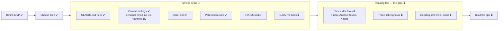

# Project status

What's done, where we are, and what's next. Updated every time something is finished.

**Legend:** ✅ done · 🔄 in progress · ⏳ not started

## Big picture

## Last session (2026-10-30 to 2026-11-02)

- Defined the MVP and wrote the README.
- Decided: downloaded app, Flutter, read the ticket on the phone with ML Kit, no cost per use.
- Set up git and GitHub (public repo `nampham2101/lotteryScanV2`).
- Harness: CLAUDE.md rules, commit settings, `/ticket` skill, permission rules, this status file.

## Next up

- Nam picks the next step: the notify-me hook, checking the Mac tools, or the reading test.

## Open questions

- Where the winning results come from, for free.
- Whether the ML Kit reader handles Vietnamese accents in province names.
- Android first? (leaning yes)

## Waiting on Nam

- Three ticket photos from three different miền Nam provinces.
