# Project status

What's done, where we are, and what's next. Updated every time something is finished.

**Legend:** ✅ done · 🔄 in progress · ⏳ not started

## Big picture

```mermaid
flowchart LR
  A["Define MVP ✅"] --> B["Choose tech ✅"] --> C
  subgraph C["Harness setup 🔄"]
    direction TB
    C1["CLAUDE.md rules ✅"]
    C2["Commit settings ✅<br/>personal email, no Co-Authored-By"]
    C3["/ticket skill ✅<br/>drafts + posts from /refine"]
    C8["/refine skill ✅<br/>discuss, split, acceptance criteria"]
    C9["Ticket workflow /work 🔄<br/>implementer agent built, see WORKFLOW.md"]
    C4["Permission rules ✅"]
    C5["STATUS.md ✅"]
    C6["Notify-me hook ⏳"]
    C7["Shared dev setup ✅<br/>Flutter 3.47.9 pinned, setup.sh"]
  end
  C --> D
  subgraph D["Reading test — the gate ⏳"]
    direction TB
    D1["Check Mac tools ✅"]
    D4["Install Flutter + Android tools ✅"]
    D2["Three ticket photos ⏳"]
    D3["Reading self-check script ⏳"]
  end
  D --> E
  subgraph E["Build the app 🔄"]
    direction TB
    E1["Blank Android app ✅<br/>ticket #2, merged"]
  end
```

## Last session (2026-10-30 to 2026-11-03)

- Defined the MVP and wrote the README.
- Decided: downloaded app, Flutter, read the ticket on the phone with ML Kit, no cost per use.
- Set up git and GitHub (public repo `nampham2101/lotteryScanV2`).
- Harness: CLAUDE.md rules, commit settings, `/ticket` skill, permission rules, this status file.
- Checked the Mac tools. Pinned Flutter 3.47.9 with FVM and added `setup.sh` and `docs/SETUP.md` for other developers (Mac and Linux).
- Added the `/refine` skill (discuss the work, split when needed, acceptance criteria: Given / When / Then for behavior, checklist otherwise, plus a "test cases needed?" mark). `/ticket` now drafts from `/refine`'s output and stays type-only.
- Designed the ticket workflow (`/work` skill, test writer, implementer, reviewer, test hook, CI) in [WORKFLOW.md](WORKFLOW.md). Not built yet. Nam's gate is at release time; at most 3 fix rounds.
- Sketched the MVP screens (home, camera with shutter, reading, won, lost, not drawn yet, can't read) and saved them as [design/screens.png](design/screens.png). Added a CLAUDE.md rule: screens follow the sketches, no invented designs.
- Listed the tickets to refine in [BACKLOG.md](BACKLOG.md): 7 for the reading gate, 3 after it.
- Decided: Android only for now. iOS can be added later without breaking anything; recorded in the README.
- Refined backlog item 1 into two tickets: #1 (write `docs/CONVENTIONS.md`) and #2 (blank Android app in `app/`, named "Dò Vé Số", package ID `com.nampham.lotteryscan`). Both posted, waiting for Nam to assign.
- `/refine` now requires proof of testing: for tasks with test cases, proof of every test run (passed or failed) is committed in `docs/evidence/<issue number>/` and linked from the PR.
- Built the implementer agent (`.claude/agents/implementer.md`, Sonnet): one branch per ticket, commits but never pushes, stops and reports when the ticket is unclear or something blocks it. Reviewer planned on Opus. Global rule changed: a blocker means stop and report, not fix.
- Enforced "the implementer never pushes" with a hook in the agent file (`.claude/hooks/block-push.sh`). Pipe-tested; not yet seen in a live agent run.
- Pinned the implementer to the full model ID `claude-sonnet-5-5`. The plain `sonnet` alias failed in the desktop app because the global settings rename it to a Gemini model meant for the local router. The router setup stays as it is. Revisit if the reviewer agent is built: it needs a full ID too.
- Wrote [CONVENTIONS.md](CONVENTIONS.md) (ticket #1): folder structure, naming, code style, commit format, scope policy. Merged to `main` and issue #1 closed.
- "Done when" boxes are now ticked by the verifier, never the implementer: Claude as manager for now (checks the evidence, shows Nam, ticks only what's proven), the reviewer agent once built. The implementer's ticking step was removed. Nam kept the six rules the implementer added beyond the ticket: single quotes, `const` where allowed, Vietnamese text for users, shared code in `app/lib/shared/`, `dart format` + `flutter analyze`, screens named `...Screen`.
- Built the blank Android app in `app/` (ticket #2, PR #3): Flutter 3.47.9, name **Dò Vé Số**, package ID `com.nampham.lotteryscan`, one blank screen, counter demo removed, one test replaces the demo test. Proof is in `docs/evidence/2/`. README "Repository" section rewritten. Claude checked the evidence and ticked the "Done when" boxes. Merged to `main` and issue #2 closed.

## Next up

Agreed order before writing code:

1. ~~Check what's installed on the Mac~~ ✅ (2026-11-02)
   - Installed: Homebrew, Android Studio, Android SDK (API 34–36.1), Android emulator with a `Pixel_10` device, Java 21, Xcode 27.1 with iOS simulators.
   - Missing: Flutter, Android command-line tools, CocoaPods (only needed for iOS, later).
2. ~~Install Flutter and the Android command-line tools~~ ✅ (2026-11-03)
   - Flutter pinned to 3.47.9 with FVM, `setup.sh` (Mac and Linux, asks before each install) and `docs/SETUP.md` written. No Docker.
   - Nam ran `./setup.sh` and installed the command-line tools. Checked: `fvm flutter doctor` passes for Flutter and Android (all licenses accepted); the `Pixel_10` emulator boots (Android 17, API 37) and Flutter sees it. Only Xcode/CocoaPods is flagged, which isn't needed while the app is Android only.
3. Nam sends the three ticket photos.
4. ~~Write `docs/CONVENTIONS.md`~~ ✅ (2026-11-03, ticket #1)
5. Refine and post the tickets in [BACKLOG.md](BACKLOG.md): `/refine`, then `/ticket`. Backlog item 1 "Create the Flutter app" is done (tickets #1 and #2).

## Open questions

- Where the winning results come from, for free.
- Whether the ML Kit reader handles Vietnamese accents in province names.

## Waiting on Nam

- Three ticket photos from three different miền Nam provinces.
