# Project status

What's done, where we are, and what's next. Updated every time something is finished.

**Legend:** ✅ done · 🔄 in progress · ⏳ not started

"Latest session" shows only the most recent session. Older history is in `git log`. Ticket details live in [BACKLOG.md](BACKLOG.md), workflow details in [WORKFLOW.md](WORKFLOW.md).

## Big picture

```mermaid
flowchart LR
  A["Define MVP ✅"] --> B["Choose tech ✅"] --> C
  subgraph C["Harness setup 🔄"]
    direction TB
    C1["CLAUDE.md rules ✅"]
    C2["Commit settings ✅<br/>personal email, no Co-Authored-By"]
    C3["/ticket skill ✅<br/>drafts + posts from /refine"]
    C8["/refine skill ✅<br/>discuss, split, acceptance criteria"]
    C9["Ticket workflow /work 🔄<br/>/work, test writer, implementer built<br/>reviewer + CI to come"]
    C4["Permission rules ✅"]
    C5["STATUS.md ✅"]
    C6["Notify-me hook ⏳"]
    C7["Shared dev setup ✅<br/>Flutter 3.47.9 pinned, setup.sh"]
  end
  C --> D
  subgraph D["Reading test — the gate ⏳"]
    direction TB
    D1["Check Mac tools ✅"]
    D4["Install Flutter + Android tools ✅"]
    D2["Three ticket photos ⏳"]
    D3["Reading self-check script ⏳"]
  end
  D --> E
  subgraph E["Build the app 🔄"]
    direction TB
    E1["Blank Android app ✅<br/>ticket #2, merged"]
    E2["Home screen ✅<br/>ticket #4, merged"]
    E3["Portrait lock ✅<br/>ticket #5, PR #7"]
  end
```

## Latest session (2026-11-04)

- Backlog item 3 refined and split into two tickets, both posted and unassigned. #8 take the photo: "Quét vé" asks for camera access, opens the sketch 2 screen, the shutter keeps the photo inside the app and returns home, and the phone's back goes home. #9 camera refused (builds on #8): one pop-up on home, whether refused once or for good. Both need test cases, and passing on the `Pixel_10` emulator is enough. A camera or save failure is not included.

## Next up

1. Build the reviewer agent (with the verify part), shaped by the #4 and #5 runs.
2. Teach `/refine` and `/ticket` to update an existing ticket, only once a ticket actually hits an unclear criterion.
3. Set up CI before tickets get bigger, so "tests must pass to merge" is enforced.
4. Backlog items 5–6 (reading the ticket, then the go / no-go gate) wait on Nam's three photos.

## Open questions

- Where the winning results come from, for free.
- Whether the ML Kit reader handles Vietnamese accents in province names.

## Waiting on Nam

- Three ticket photos from three different miền Nam provinces.
