# Project status

What's done, where we are, and what's next. Updated every time something is finished.

**Legend:** ✅ done · 🔄 in progress · ⏳ not started

"Latest session" shows only the most recent session. Older history is in `git log`. Ticket details live in [BACKLOG.md](BACKLOG.md), workflow details in [WORKFLOW.md](WORKFLOW.md).

## Big picture

```mermaid
flowchart LR
  A["Define MVP ✅"] --> B["Choose tech ✅"] --> C
  subgraph C["Harness setup 🔄"]
    direction TB
    C1["CLAUDE.md rules ✅"]
    C2["Commit settings ✅<br/>personal email, no Co-Authored-By"]
    C3["/ticket skill ✅<br/>drafts + posts from /refine"]
    C8["/refine skill ✅<br/>discuss, split, acceptance criteria"]
    C9["Ticket workflow /work 🔄<br/>implementer agent built, see WORKFLOW.md"]
    C4["Permission rules ✅"]
    C5["STATUS.md ✅"]
    C6["Notify-me hook ⏳"]
    C7["Shared dev setup ✅<br/>Flutter 3.47.9 pinned, setup.sh"]
  end
  C --> D
  subgraph D["Reading test — the gate ⏳"]
    direction TB
    D1["Check Mac tools ✅"]
    D4["Install Flutter + Android tools ✅"]
    D2["Three ticket photos ⏳"]
    D3["Reading self-check script ⏳"]
  end
  D --> E
  subgraph E["Build the app 🔄"]
    direction TB
    E1["Blank Android app ✅<br/>ticket #2, merged"]
  end
```

## Latest session (2026-11-03)

- Tickets #1 (`docs/CONVENTIONS.md`) and #2 (blank Android app "Dò Vé Số", PR #3) are done, merged and closed. First real run of the workflow: `/refine` → `/ticket` → assign → implementer → evidence → verifier ticks → PR → merge.
- Built the implementer agent (Sonnet, full model ID `claude-sonnet-5-5`), with a hook that blocks `git push` while it runs.
- "Done when" boxes are ticked by the verifier (Claude for now, the reviewer later), never the implementer.
- Flutter 3.47.9 and the Android tools are installed and checked; the `Pixel_10` emulator works.
- Cleanup: backlog item 1 marked done, PR #3's evidence links now point to `main`, the merged branch is deleted. Rules for both added to WORKFLOW.md. This file trimmed to the latest session.

## Next up

1. Refine backlog item 2, the home screen with the "Quét vé" button: `/refine`, then `/ticket`.
2. Build the test writer agent before backlog item 3 (the camera), the first ticket with real behavior to test.
3. Set up CI before tickets get bigger, so "tests must pass to merge" is enforced.
4. Backlog items 5–6 (reading the ticket, then the go / no-go gate) wait on Nam's three photos.

## Open questions

- Where the winning results come from, for free.
- Whether the ML Kit reader handles Vietnamese accents in province names.

## Waiting on Nam

- Three ticket photos from three different miền Nam provinces.
