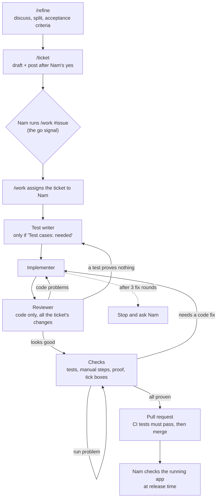

# Ticket workflow

How a piece of work goes from an idea to merged code.

**Status:** partly built (`/refine`, `/ticket`, `/work`, test writer, implementer, reviewer). Each remaining piece gets built when the first real ticket needs it.

## The flow

## The pieces

| Piece | Type | Job | Built? |
|---|---|---|---|
| `/refine` | Skill | Discuss the work, split when needed, write acceptance criteria, mark "test cases needed?" | ✅ |
| `/ticket` | Skill | Draft and post the GitHub issue from `/refine`'s output. `/ticket update <issue number>` changes an existing ticket, after Nam's yes | ✅ |
| `/work` | Skill | Assign one ticket to Nam and run it from test writer to merge, in our conversation. Nam types `/work <issue number>`, and that is the go signal. See `.claude/skills/work/SKILL.md` | ✅ |
| Test writer | Agent (Opus) | Write widget tests, integration tests and manual steps from the ticket's acceptance criteria only, before any code exists, on the ticket's branch. See `.claude/agents/test-writer.md` | ✅ |
| Implementer | Agent (Sonnet) | Write the code for the ticket on its own branch, then report. See `.claude/agents/implementer.md` | ✅ |
| Test check | Hook | Run the tests automatically and report failures | ⏳ |
| Reviewer | Agent (Opus) | Review the code with fresh eyes, across all the ticket's changes, before the checks. See `.claude/agents/reviewer.md` | ✅ |
| CI | GitHub Actions | Tests must pass before a pull request can merge | ⏳ |
| Regression run | Not designed yet | Run every test, including the ones that need the phone, before a release | ⏳ |

## Rules

- **Nam's gate is at release time.** The flow checks itself and tests must pass to merge. Nam checks the running app when a release is tagged.
- **At most 3 fix rounds.** If tests keep failing or the reviewer keeps finding problems, the flow stops and asks Nam.
- **Test cases are written when work starts**, not when the ticket is created. A ticket is only a proposal until Nam runs `/work` on it.
- **Agents report, `/work` decides.** The hook and the reviewer report problems; `/work` sends the work back to the right step.
- **Build one piece at a time**, when a real ticket needs it. Suggested order: implementer, test check, test writer, reviewer, `/work`, CI.
- **Implementer rules:** one branch per ticket (`ticket-<number>-<short-name>`), commits there, never pushes or opens a pull request. "Never push" is enforced by a hook (`.claude/hooks/block-push.sh`) that runs only while the implementer runs and blocks any `git push`. If the ticket is unclear or leaves a choice open, it stops and reports the question. If something blocks the ticket, it stops and reports. Trivial fixes in files it's already changing are allowed and reported. It runs analyze, the widget tests, the ticket's new tests and the older tests the test writer updated, and no other older tests. Before and after changing a screen, it takes a screenshot of it, compares them with each other and with the sketch, and fixes anything the ticket didn't ask to change. After a fix, it names the tests related to what the fix changed, and only those rerun.
- **"Done when" boxes are ticked in `/work`'s checks step, never by the implementer.** After the tests and manual steps, `/work` proves each item against the saved evidence and ticks the boxes only when everything passes and is proven. Nam doesn't tick boxes by hand.
- **Evidence links in a pull request point to `main`** (`.../blob/main/docs/evidence/<issue>/...`), not to the ticket branch, so they keep working after the branch is deleted.
- **After merge, delete the ticket branch**, locally and on GitHub. Pull requests are squash-merged, so check the branch's content is on `main` (`git diff <branch> main`) rather than relying on `git branch --merged`.
- **Agents use full model IDs** (e.g. `claude-sonnet-5-5`), not aliases like `sonnet`: Nam's global settings point the aliases at a local router.
- **Test writer rules:** runs first, only for tickets marked "Test cases: needed". It creates the ticket's branch, writes tests only for what the ticket adds or changes, from "Done when" only (never from the implementer's code). When the ticket changes an older feature on purpose, it updates only the older tests that expect the old behaviour and lists them in `docs/tests/<issue>.md`. When the ticket removes a feature on purpose, it deletes the older tests that check only that feature and lists each, with the reason, under "Removed" in the same file; it never deletes a test because it fails or is in the way, and an older test whose behaviour stays is updated, not deleted. It runs the new and updated tests, once, to prove they fail because the feature or change is missing (no other older tests, and never against a stand-in version of the feature), saves that run in `docs/evidence/<issue>/first-run.txt`, commits, and reports. It may only write in `app/test/`, `app/integration_test/`, `docs/tests/<issue>.md`, `docs/evidence/<issue>/first-run.txt`, `app/pubspec.yaml` (test add-ons) and `app/pubspec.lock`; a hook (`.claude/hooks/test-writer-paths.sh`) blocks anything else, and the block-push hook applies too. The implementer doesn't write or change tests; a hook (`.claude/hooks/implementer-no-tests.sh`) blocks it, and `/work` also checks no test file changed after the test writer's commit.
- **Reviewer rules:** runs after the implementer and before the checks, given only the ticket number, never the implementer's report. It reviews the code only, across all the ticket's changes every time, reports every problem at once, and changes nothing: it has no file-editing tools, though it can run shell commands, so "never change files" rests on its instructions. The block-push hook applies too. All its problems go back together, as one fix round, shared with the checks. Improvements and style preferences go to the backlog, not back to the implementer.
- **Code fixes go through the reviewer again.** Any code fix after a failed check returns to the reviewer before the checks rerun. The checks then rerun only analyze, the widget tests, the tests the implementer named as related to the fix, and any test the test writer fixed. A run problem with no code fix just reruns the check. Both count as a fix round.
- **Device rule:** the test writer decides where each test runs, and `docs/tests/<issue>.md` says which device each one uses and why in its "Where these run" line. A device named in the ticket wins. Otherwise the default is the `Pixel_10` emulator, and a real phone is used only when the emulator can't prove the item, like a live camera picture. Tests that need the phone go in their own file. `/refine` names a device only when Nam asks. The phone's serial goes in `ANDROID_SERIAL`, never in the repo, and every command names its device. Evidence says which device each run used.
- **What the checks run:** every ticket runs analyze, all the widget tests, its new tests, the older tests the test writer updated, and its manual steps. No other older tests run, even if the ticket touched their code. Earlier passing runs count as proof, and there is no final run of all the ticket's tests before the merge. All the tests run in the regression run before a release.
- **Unclear criteria go back to `/refine`.** If the test writer can't test a criterion as written, it stops and reports. Claude shows Nam the question, Nam fixes the criterion with `/refine`, `/ticket update` applies it to the ticket, then the test writer runs again.
- **`/work` merges by itself** once every check passes: analyze, widget tests, the ticket's integration tests, manual steps, no test files changed, every "Done when" item proven, and the reviewer says it looks good. Nam steps in only when it stops. Until CI exists, these checks run inside `/work` only.
- **`/work` routing:**

  | What fails | Where it goes | Fix round? |
  |---|---|---|
  | The reviewer finds code problems | All back to the implementer, then the reviewer again | Yes |
  | The reviewer finds a test that proves nothing | Back to the test writer in the same round, to fix that test on the existing branch | Yes |
  | A check fails, or a "Done when" item isn't proven, and it needs a code fix | Back to the implementer, then the reviewer, then the checks | Yes |
  | A check fails with no code fix needed (a run problem, or proof not saved) | Run that check again | Yes |
  | The implementer says a test contradicts the ticket | Stop and ask Nam (the ticket may need `/refine`) | — |
  | The test writer stops on an unclear criterion | Stop and ask Nam to run `/refine` | — |
  | Any agent stops on a blocker or security risk | Stop and ask Nam | — |
  | Tests need a real phone and none is connected | Stop and tell Nam | — |
  | 3 fix rounds used up | Stop, and show Nam what was tried | — |

- **A workflow change can leave tickets out of date.** When a rule changes, check the open tickets and update them with `/ticket update`.
- **Findings go to BACKLOG.md** as "not refined" items. Nothing is posted to GitHub without Nam.

## Decisions and reasons

| Decision | Why | Revisit if |
|---|---|---|
| Skills for steps that talk with Nam, agents for steps that don't | An agent can't stop midway to discuss with Nam; a skill runs in the conversation and can | An agent type gains a way to ask questions mid-task |
| Reviewer is a separate agent | It starts fresh, without the implementer's reasoning, so it catches more | — |
| Reviewer before the checks | #8 ran a full test pass before each of its 4 reviews. Reviewing first means the slow device tests and manual steps run on code already reviewed | Checks often fail on code the reviewer passed |
| The reviewer reads all the ticket's changes every time | A fix can break something outside the lines it touched | Reviews take too long on bigger tickets |
| `/work`'s checks step proves "Done when" and ticks the boxes, not the reviewer or the implementer | The reviewer stays on code, and the proof can only exist after the checks. The builder still doesn't certify its own work; ticking right after commit would show the ticket done before tests, review and merge; the implementer needs no GitHub write access | A ticket merges with a "Done when" item that wasn't really proven |
| Improvements go to the backlog, not back to the implementer | Fix rounds stay on real problems. #8 used all 3 | Backlog improvements pile up without being done |
| Manual steps cover only what automated tests can't prove | In #8, steps 1 and 5 mostly repeated automated tests, and every full pass ran them again | A problem only a person would see gets through |
| Test writer on Opus | It defines what "correct" means, so its mistakes cost the most; a different model from the implementer won't share its misreading of a criterion | Its tests are consistently simple and right first time → Sonnet would do |
| Implementer on Sonnet | Tickets are small and precise; Sonnet is strong at code and uses less of the plan's usage | It often uses up its 3 fix rounds, or stops on things it should handle → switch to Opus |
| Reviewer on Opus | A different model from the implementer shares fewer blind spots, so it catches more | — |
| `/ticket` doesn't start the test writer | Wrong moment: tickets aren't approved until Nam runs `/work`. Keeps each skill to one job | Test cases written at work start turn out to be too late |
| Running `/work` is the go signal, and `/work` assigns the ticket | Nam shouldn't have to go to GitHub just to start a ticket. Only Nam can start `/work`, so the approval stays with Nam | Something other than Nam can start `/work`, or more people work on tickets |
| The test writer picks the device for each test, with the emulator as default | Most tests don't need the phone: 11 of #8's 12 camera tests passed on the emulator in one run. The phone needs Nam holding it, so using it only where needed lets more of `/work` run unattended. This replaces "real phone first" | A bug that only shows on a real phone reaches the release check |
| A ticket tests only what it adds or changes. Older tests run only when the ticket changes their feature on purpose, and only the tests the test writer updated, not their whole file | Nam: "only test what we change". Under the old rule, #24 changed the shared home, camera and photo screens, so all seven older features' tests ran, including #5's rotation tests, and #24 saved 40 device runs over four fix rounds. Analyze and widget tests still run on every ticket because they take seconds | An older feature breaks and isn't noticed until Nam uses the app |
| The test writer and the implementer run the same tests as the checks | Their runs repeat what the checks do later and cost time and tokens. The test writer's stand-in versions in #9 and #10 were extra runs the workflow never asked for | The checks often fail on tests these agents could have caught, using up fix rounds |
| After a fix, only the tests related to it rerun, and there is no final run of all the ticket's tests before the merge | Rerunning everything every round made up most of #24's runs. Nam declined the final run | A fix breaks one of the ticket's own tests and it reaches `main` |
| The implementer picks which tests are related to a fix | It made the fix, so it knows what the fix touched. Nam first chose the test writer, then changed to the implementer, which also saves an extra test-writer run on Opus in every round | The implementer names too few tests and a broken one gets through |
| The implementer compares before-and-after screenshots of every screen it changes, instead of tests that check positions | In #24, adding a note moved the home screen left. No test checks where things sit, and no ticket can list every side effect, so whoever makes the change has to look. `/work` caught it only by chance on a screenshot | A side effect on a screen reaches `main` |
| These rules start before the regression run exists | Nam wants shorter tickets now | When the regression run is designed, or an older feature breaks unnoticed |
| Gate at release, not at each pull request | Nam's attention goes to the running app instead of code diffs | Releases start shipping problems the flow should have caught |
| 3-round loop limit | Stops endless fix loops, like the 24-hour runs in the previous attempt | 3 rounds turns out too few or too many in practice |

**Accepted risks** (from choosing the release-time gate):
- `main` may hold code Nam hasn't reviewed, and changes bundle between releases.
- The reviewer agent catches slips but shares Claude's blind spots about design. The release check is the only gate for those.
- `/work` runs the checks and judges its own evidence, with no separate agent looking at the proof.
- Most tests run on the emulator, so a bug that only shows on a real phone may first appear at the release check.
- A ticket can break an older feature, or a later fix can break one of the ticket's own tests, and it stays on `main` until the regression run. Several tickets may need checking to find which one did it. The regression run isn't designed yet, so until it is, only Nam using the app would find such a break.
- The implementer judges which tests its own fix touches, and the checks rerun only those.

## Still to decide (when building)

- Confirm GitHub Actions is free for this public repository before setting up CI.
- How the regression run works before a release: what starts it, and how the tests that need the phone fit in.
- Whether the implementer's before-and-after screenshots are saved as proof. For now they're only described in its report.
