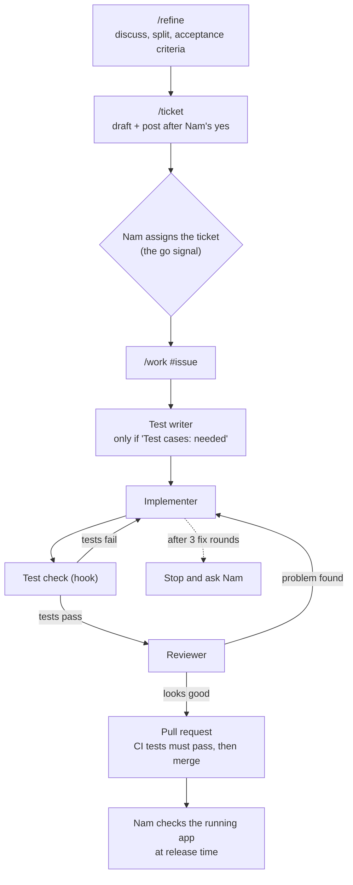

# Ticket workflow

How a piece of work goes from an idea to merged code.

**Status:** partly built (`/refine`, `/ticket`, implementer). Each remaining piece gets built when the first real ticket needs it.

## The flow

## The pieces

| Piece | Type | Job | Built? |
|---|---|---|---|
| `/refine` | Skill | Discuss the work, split when needed, write acceptance criteria, mark "test cases needed?" | ✅ |
| `/ticket` | Skill | Draft and post the GitHub issue from `/refine`'s output | ✅ |
| `/work` | Skill | Run one assigned ticket through the steps below, in our conversation | ⏳ |
| Test writer | Agent | Write test cases from the ticket's acceptance criteria, if the ticket says they're needed | ⏳ |
| Implementer | Agent (Sonnet) | Write the code for the ticket on its own branch, then report. See `.claude/agents/implementer.md` | ✅ |
| Test check | Hook | Run the tests automatically and report failures | ⏳ |
| Reviewer | Agent (Opus, planned) | Review the implementer's code with fresh eyes | ⏳ |
| CI | GitHub Actions | Tests must pass before a pull request can merge | ⏳ |

## Rules

- **Nam's gate is at release time.** The flow checks itself and tests must pass to merge. Nam checks the running app when a release is tagged.
- **At most 3 fix rounds.** If tests keep failing or the reviewer keeps finding problems, the flow stops and asks Nam.
- **Test cases are written when work starts**, not when the ticket is created. Unassigned tickets are only proposals.
- **Agents report, `/work` decides.** The hook and the reviewer report problems; `/work` sends the work back to the right step.
- **Build one piece at a time**, when a real ticket needs it. Suggested order: implementer, test check, test writer, reviewer, `/work`, CI.
- **Implementer rules:** one branch per ticket (`ticket-<number>-<short-name>`), commits there, never pushes or opens a pull request. "Never push" is enforced by a hook (`.claude/hooks/block-push.sh`) that runs only while the implementer runs and blocks any `git push`. If the ticket is unclear or leaves a choice open, it stops and reports the question. If something blocks the ticket, it stops and reports. Trivial fixes in files it's already changing are allowed and reported.
- **"Done when" boxes are ticked by the verifier, never the implementer.** For now the manager (Claude in the main conversation, later `/work`) checks the implementer's evidence against each item, shows Nam the result, and ticks only what's proven. Once built, the reviewer agent does this. Nam doesn't tick boxes by hand.
- **Temporary exception:** until the test writer exists, the implementer writes simple tests itself (e.g. #2's "the app starts" test). The test writer gets built before the first ticket with real behavior to test.

## Decisions and reasons

| Decision | Why | Revisit if |
|---|---|---|
| Skills for steps that talk with Nam, agents for steps that don't | An agent can't stop midway to discuss with Nam; a skill runs in the conversation and can | An agent type gains a way to ask questions mid-task |
| Reviewer is a separate agent | It starts fresh, without the implementer's reasoning, so it catches more | — |
| The verifier ticks "Done when" boxes, not the implementer | The builder shouldn't certify its own work; ticking right after commit would show the ticket done before tests, review and merge; the implementer needs no GitHub write access | — |
| Implementer on Sonnet | Tickets are small and precise; Sonnet is strong at code and uses less of the plan's usage | It often uses up its 3 fix rounds, or stops on things it should handle → switch to Opus |
| Reviewer on Opus (planned) | A different model from the implementer shares fewer blind spots, so it catches more | — |
| `/ticket` doesn't start the test writer | Wrong moment: tickets aren't approved until assigned. Keeps each skill to one job | Test cases written at work start turn out to be too late |
| Gate at release, not at each pull request | Nam's attention goes to the running app instead of code diffs | Releases start shipping problems the flow should have caught |
| 3-round loop limit | Stops endless fix loops, like the 24-hour runs in the previous attempt | 3 rounds turns out too few or too many in practice |

**Accepted risks** (from choosing the release-time gate):
- `main` may hold code Nam hasn't reviewed, and changes bundle between releases.
- The reviewer agent catches slips but shares Claude's blind spots about design. The release check is the only gate for those.

## Still to decide (when building)

- Exactly where each problem goes back to: e.g. a failing test caused by a wrong test → test writer; caused by wrong code → implementer.
- Where test cases live (ticket comment, test files, or both).
- Confirm GitHub Actions is free for this public repository before setting up CI.
