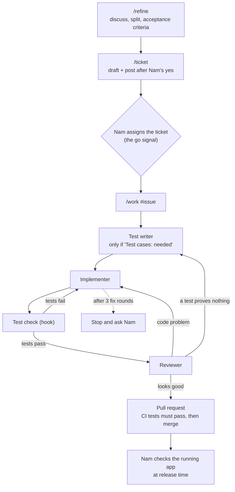

# Ticket workflow

How a piece of work goes from an idea to merged code.

**Status:** partly built (`/refine`, `/ticket`, `/work`, test writer, implementer, reviewer). Each remaining piece gets built when the first real ticket needs it.

## The flow

## The pieces

| Piece | Type | Job | Built? |
|---|---|---|---|
| `/refine` | Skill | Discuss the work, split when needed, write acceptance criteria, mark "test cases needed?" | ✅ |
| `/ticket` | Skill | Draft and post the GitHub issue from `/refine`'s output | ✅ |
| `/work` | Skill | Run one assigned ticket from test writer to merge, in our conversation. Nam types `/work <issue number>`. See `.claude/skills/work/SKILL.md` | ✅ |
| Test writer | Agent (Opus) | Write widget tests, integration tests and manual steps from the ticket's acceptance criteria only, before any code exists, on the ticket's branch. See `.claude/agents/test-writer.md` | ✅ |
| Implementer | Agent (Sonnet) | Write the code for the ticket on its own branch, then report. See `.claude/agents/implementer.md` | ✅ |
| Test check | Hook | Run the tests automatically and report failures | ⏳ |
| Reviewer | Agent (Opus) | Review the finished work with fresh eyes, prove each "Done when" item against the evidence, and tick the boxes. See `.claude/agents/reviewer.md` | ✅ |
| CI | GitHub Actions | Tests must pass before a pull request can merge | ⏳ |

## Rules

- **Nam's gate is at release time.** The flow checks itself and tests must pass to merge. Nam checks the running app when a release is tagged.
- **At most 3 fix rounds.** If tests keep failing or the reviewer keeps finding problems, the flow stops and asks Nam.
- **Test cases are written when work starts**, not when the ticket is created. Unassigned tickets are only proposals.
- **Agents report, `/work` decides.** The hook and the reviewer report problems; `/work` sends the work back to the right step.
- **Build one piece at a time**, when a real ticket needs it. Suggested order: implementer, test check, test writer, reviewer, `/work`, CI.
- **Implementer rules:** one branch per ticket (`ticket-<number>-<short-name>`), commits there, never pushes or opens a pull request. "Never push" is enforced by a hook (`.claude/hooks/block-push.sh`) that runs only while the implementer runs and blocks any `git push`. If the ticket is unclear or leaves a choice open, it stops and reports the question. If something blocks the ticket, it stops and reports. Trivial fixes in files it's already changing are allowed and reported.
- **"Done when" boxes are ticked by the reviewer, never the implementer.** The reviewer checks each item against the saved evidence and ticks the boxes only if the whole review looks good. Nam doesn't tick boxes by hand.
- **Evidence links in a pull request point to `main`** (`.../blob/main/docs/evidence/<issue>/...`), not to the ticket branch, so they keep working after the branch is deleted.
- **After merge, delete the ticket branch**, locally and on GitHub. Pull requests are squash-merged, so check the branch's content is on `main` (`git diff <branch> main`) rather than relying on `git branch --merged`.
- **Agents use full model IDs** (e.g. `claude-sonnet-5-5`), not aliases like `sonnet`: Nam's global settings point the aliases at a local router.
- **Test writer rules:** runs first, only for tickets marked "Test cases: needed". It creates the ticket's branch, writes the tests from "Done when" only (never from the implementer's code), runs them once to prove they fail because the feature is missing, saves that run in `docs/evidence/<issue>/first-run.txt`, commits, and reports. It may only write in `app/test/`, `app/integration_test/`, `docs/tests/<issue>.md`, `docs/evidence/<issue>/first-run.txt`, `app/pubspec.yaml` (test add-ons) and `app/pubspec.lock`; a hook (`.claude/hooks/test-writer-paths.sh`) blocks anything else, and the block-push hook applies too. The implementer doesn't write or change tests; a hook (`.claude/hooks/implementer-no-tests.sh`) blocks it, and `/work` also checks no test file changed after the test writer's commit.
- **Reviewer rules:** runs after the checks pass, given only the ticket number, never the implementer's report. It reviews the branch against the ticket, proves each "Done when" item from `docs/evidence/<issue>/`, and reports. Ticking boxes is its only change: it has no file-editing tools, though it can run shell commands, so "never change files" rests on its instructions. The block-push hook applies too. Its problems use the same 3 fix rounds as the checks. Style preferences are suggested issues, not problems.
- **Unclear criteria go back to `/refine`.** If the test writer can't test a criterion as written, it stops and reports. Claude shows Nam the question, Nam fixes the ticket with `/refine`, then the test writer runs again. (`/refine` and `/ticket` can't update an existing ticket yet. That gets built only when a ticket actually hits an unclear criterion.)
- **`/work` merges by itself** once every check passes: analyze, widget and integration tests, manual steps, no test files changed, every "Done when" item proven, and the reviewer says it looks good. Nam steps in only when it stops. Until CI exists, these checks run inside `/work` only.
- **`/work` routing:**

  | What fails | Where it goes | Fix round? |
  |---|---|---|
  | Tests still fail after the implementer | Back to the implementer, with the failing output | Yes |
  | An unmet "Done when" item | Back to the implementer, with what's missing | Yes |
  | The reviewer finds a code problem | Back to the implementer, with what's wrong | Yes |
  | The reviewer finds a test that proves nothing | Back to the test writer, to fix that test on the existing branch | Yes |
  | The implementer says a test contradicts the ticket | Stop and ask Nam (the ticket may need `/refine`) | — |
  | The test writer stops on an unclear criterion | Stop and ask Nam to run `/refine` | — |
  | Any agent stops on a blocker or security risk | Stop and ask Nam | — |
  | 3 fix rounds used up | Stop, and show Nam what was tried | — |

- **Findings go to BACKLOG.md** as "not refined" items. Nothing is posted to GitHub without Nam.

## Decisions and reasons

| Decision | Why | Revisit if |
|---|---|---|
| Skills for steps that talk with Nam, agents for steps that don't | An agent can't stop midway to discuss with Nam; a skill runs in the conversation and can | An agent type gains a way to ask questions mid-task |
| Reviewer is a separate agent | It starts fresh, without the implementer's reasoning, so it catches more | — |
| The reviewer ticks "Done when" boxes, not the implementer | The builder shouldn't certify its own work; ticking right after commit would show the ticket done before tests, review and merge; the implementer needs no GitHub write access | — |
| Test writer on Opus | It defines what "correct" means, so its mistakes cost the most; a different model from the implementer won't share its misreading of a criterion | Its tests are consistently simple and right first time → Sonnet would do |
| Implementer on Sonnet | Tickets are small and precise; Sonnet is strong at code and uses less of the plan's usage | It often uses up its 3 fix rounds, or stops on things it should handle → switch to Opus |
| Reviewer on Opus | A different model from the implementer shares fewer blind spots, so it catches more | — |
| `/ticket` doesn't start the test writer | Wrong moment: tickets aren't approved until assigned. Keeps each skill to one job | Test cases written at work start turn out to be too late |
| Gate at release, not at each pull request | Nam's attention goes to the running app instead of code diffs | Releases start shipping problems the flow should have caught |
| 3-round loop limit | Stops endless fix loops, like the 24-hour runs in the previous attempt | 3 rounds turns out too few or too many in practice |

**Accepted risks** (from choosing the release-time gate):
- `main` may hold code Nam hasn't reviewed, and changes bundle between releases.
- The reviewer agent catches slips but shares Claude's blind spots about design. The release check is the only gate for those.

## Still to decide (when building)

- Confirm GitHub Actions is free for this public repository before setting up CI.
